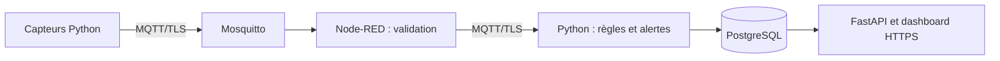

# Smartcare

Les parcours d’inscription, de validation, de gestion des patients, d’alertes et d’audit sont
résumés dans [docs/WORKFLOWS_CLINIQUES.md](docs/WORKFLOWS_CLINIQUES.md).

Smartcare est un mini-projet de télésurveillance IoT multipatient.
Des capteurs Python simulés envoient des mesures ; le système les valide et applique les règles des profils diabète, hypertension et stress.
Le résultat s’affiche dans un dashboard avec des alertes : il ne pose aucun diagnostic médical.



## Prérequis

- Python **3.11 ou plus récent**, avec `venv` et `pip`.
- Docker Desktop démarré sur Windows/macOS, ou Docker Engine avec Compose sur Linux.
- Docker Compose **2.24.4 minimum** ; accès Internet pour la première installation.
- Ports locaux disponibles : **8000**, **8883**, **5433** et **1880** si Node-RED est affiché.

Exécuter les commandes à la racine du dépôt. Aucun schéma préexistant n’est nécessaire : le défaut est `smartcare`.

## Installer puis démarrer

Créer et activer l’environnement une seule fois :

**macOS / Linux**

```sh
python3 -m venv .venv
source .venv/bin/activate
```

**Windows PowerShell**

```powershell
py -3 -m venv .venv
.venv\Scripts\Activate.ps1
```

Si PowerShell bloque l’activation, utiliser `cmd` et `.venv\Scripts\activate.bat`.
Puis, avec l’environnement activé, les commandes sont identiques :

```sh
python -m pip install -r requirements.txt
python smartcare.py start-demo --node-red
```

Cette commande prépare les secrets s’ils n’existent pas, démarre les trois services Docker,
initialise PostgreSQL et lance le serveur avec son récepteur MQTT. Elle conserve les clés,
les comptes et les historiques existants. Elle reste ouverte dans ce premier terminal.
Omettre `--node-red` pour laisser l’éditeur fermé.

### Connexion locale

- Dashboard : **https://127.0.0.1:8000/login**.
- Premier compte de démonstration : **`admin`**.
- Au premier lancement, choisir un mot de passe de **12 à 128 caractères** dans le terminal.
  Il est enregistré dans le fichier privé `.env`, ignoré par Git, sans être affiché.
- On peut aussi créer `.env` à partir de `.env.example` et y définir
  `SMARTCARE_DEMO_ADMIN_PASSWORD` avant le lancement. Ne pas partager ce fichier.
- Si un compte existe déjà dans le schéma, **aucun compte ni mot de passe n’est modifié**.
  Utiliser alors ses identifiants habituels, même si la variable `.env` a changé.

Le navigateur doit faire confiance à la CA créée localement :
[importer `.secrets/tls/ca.crt`](docs/SECURITE_ET_TESTS.md#certificats-locaux).
HTTPS et MQTT/TLS restent activés en démonstration.

## Voir les trois scénarios

Dans un **second terminal**, activer le même environnement. Lancer un scénario à la fois ;
`Ctrl+C` l’arrête. Les commandes publient réellement vers MQTT, sans données injectées dans le navigateur.

```sh
python smartcare.py simulate normal
python smartcare.py simulate anomaly
python smartcare.py simulate disconnection
```

| Scénario | Ce qu’on doit observer |
| --- | --- |
| `normal` | Mesures de P001/P002/P003 ; courbe alimentée. Attendre environ 15 s pour que les tendances puissent être évaluées. |
| `anomaly` | Glycémie simulée de P001 à 240 mg/dL ; avec les règles livrées, une alerte apparaît. Les autres patients continuent normalement. |
| `disconnection` | P001 émet 15 s, se tait 20 s avec le délai livré, puis reprend ; P002/P003 continuent. État « Capteur déconnecté », incident technique, puis récupération. |

Chaque scénario dure **60 s** par défaut (`--duration 120` pour deux minutes).
La fin d’un simulateur entraîne ensuite une déconnexion attendue : ce n’est pas une panne du dashboard.
L’état « À surveiller » signifie notamment que les données sont insuffisantes ou anciennes.
Une récupération technique ne suffit pas à résoudre une alerte physiologique.

## Montrer Node-RED

Avec `start-demo --node-red`, ouvrir **https://127.0.0.1:1880**.
L’utilisateur de l’éditeur est `admin`, avec le mot de passe de démo choisi lors de la **première préparation de cet éditeur**.
Il s’agit d’un compte distinct, en lecture seule : montrer le flow sans le redéployer.
L’éditeur et son API exigent une authentification ; le port est lié uniquement à `127.0.0.1`.
Le [script de présentation](docs/DEMONSTRATION.md) explique quoi montrer et dans quel ordre.

## Arrêter proprement

1. `Ctrl+C` dans le terminal du simulateur.
2. `Ctrl+C` dans celui du serveur.
3. `python smartcare.py stop` pour arrêter les conteneurs.

Les volumes et les historiques sont conservés. Ne pas utiliser `down -v` ni supprimer `.secrets`.
Sauvegarder `.secrets/storage.key` séparément : elle permet de relire les historiques chiffrés.

## Cinq problèmes fréquents

| Problème | Action |
| --- | --- |
| Docker indisponible | Démarrer Docker Desktop et attendre que son moteur soit prêt, puis relancer. |
| Port déjà occupé | Arrêter l’ancien serveur/la pile de test ; ne pas lancer deux récepteurs sur le même schéma. |
| Aucune mesure | Lancer `simulate normal`, sélectionner P001, vérifier « Réception active » et son consentement dans Administration. |
| Connexion refusée | Vérifier le mot de passe privé ; un compte existant n’est jamais réinitialisé par `start-demo`. Vérifier aussi le schéma utilisé. |
| Certificat refusé ou secret manquant | Vérifier la date système et la CA locale ; restaurer les fichiers privés manquants. Ne jamais recréer la clé de stockage pour tenter de réparer la lecture. |

## Comprendre et vérifier

- [Comprendre tout le projet en six étapes](docs/COMPRENDRE_SMARTCARE.md).
- [Démonstration orale de 3 à 5 minutes](docs/DEMONSTRATION.md).
- [Architecture simple et rôle de chaque composant](docs/ARCHITECTURE_SIMPLE.md).
- [Sécurité, modes de lancement, tests et limites](docs/SECURITE_ET_TESTS.md).
- [Vérification de cette simplification et fichiers modifiés](docs/VALIDATION_SIMPLIFICATION.md).

Les documents `docs/step*.md`, le [résumé des 12 étapes](docs/resume_etapes.md) et
la [traçabilité UML](docs/uml_traceability.md) sont des références historiques et détaillées.
Leurs anciens résultats de tests ne constituent pas une validation de la version actuelle.
