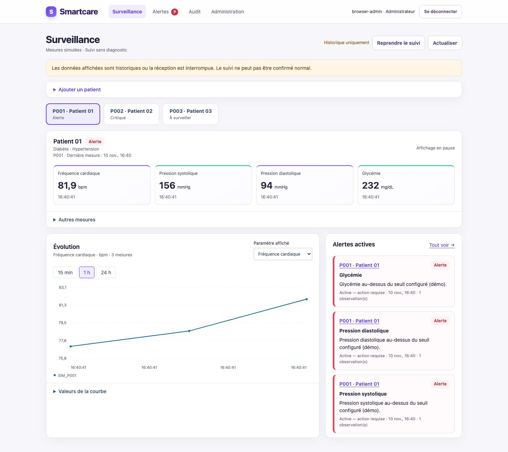
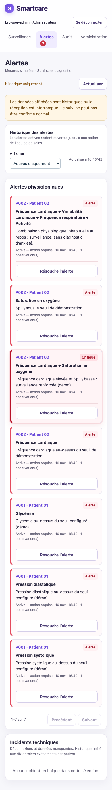
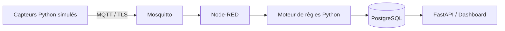

# Smartcare

Smartcare est notre prototype de télésurveillance médicale IoT.

L’idée est assez simple : des capteurs Python simulés envoient des mesures avec MQTT,
Node-RED vérifie les messages, puis le backend analyse les données selon le profil du patient.
On peut ensuite consulter les mesures, les courbes et les alertes dans une application web.

> C’est un projet pédagogique de surveillance. Il ne réalise aucun diagnostic médical.

## Aperçu de l’application

### Surveillance des patients



### Alertes sur mobile

<p align="center">
  
</p>

## Ce qu’on a réalisé

- surveillance de plusieurs patients ;
- profils diabète, hypertension et suivi stress/anxiété ;
- mesures simulées : fréquence cardiaque, SpO₂, température, tension, glycémie, respiration, HRV et activité ;
- transmission MQTT avec Mosquitto ;
- validation et routage avec Node-RED ;
- règles par seuil, tendance et combinaison de paramètres ;
- alertes actives jusqu’à leur résolution par un professionnel ;
- historique des mesures, alertes et incidents techniques ;
- comptes administrateur, médecin et infirmier ;
- inscription des professionnels avec validation par l’administrateur ;
- ajout de patients et de leurs profils ;
- stockage PostgreSQL et dashboard FastAPI ;
- HTTPS, MQTT/TLS, mots de passe hachés et données sensibles chiffrées.

## Architecture résumée



En pratique, Node-RED sert surtout à recevoir, vérifier et router les messages.
Les règles cliniques, les alertes, les utilisateurs et les patients sont gérés par le backend Python.

## Lancer le projet

Il faut avoir Python 3.11 ou plus récent et Docker Desktop démarré.

### 1. Préparer Python

Sur macOS ou Linux :

```sh
python3 -m venv .venv
source .venv/bin/activate
python -m pip install -r requirements.txt
```

Sur Windows PowerShell :

```powershell
py -3 -m venv .venv
.venv\Scripts\Activate.ps1
python -m pip install -r requirements.txt
```

### 2. Démarrer Smartcare

```sh
python smartcare.py start-demo --node-red
```

Au premier lancement, le programme demande le mot de passe du compte `admin`.
Les secrets sont créés uniquement dans `.env` et `.secrets`, qui sont ignorés par Git.

Une fois le démarrage terminé :

- application : **https://127.0.0.1:8000/login** ;
- Node-RED : **https://127.0.0.1:1880** ;
- utilisateur initial : **admin** ;
- mot de passe : celui choisi au premier lancement.

Le certificat HTTPS est local. La procédure pour lui faire confiance est expliquée dans
[la documentation sécurité](docs/SECURITE_ET_TESTS.md#certificats-locaux).

## Tester les scénarios

Dans un deuxième terminal, avec le même environnement Python activé :

```sh
python smartcare.py simulate normal
python smartcare.py simulate anomaly
python smartcare.py simulate disconnection
```

Mes notes pour la démonstration :

- `normal` : les trois patients reçoivent des mesures normales ;
- `anomaly` : P001 reçoit une glycémie anormale et une alerte apparaît ;
- `disconnection` : P001 arrête temporairement d’émettre, puis se reconnecte ;
- une alerte physiologique ne disparaît pas toute seule : un professionnel doit la résoudre.

## Les rôles

- **Administrateur** : valide les inscriptions, gère les comptes, les patients et les consentements.
- **Médecin** : consulte le suivi, ajoute des patients et résout les alertes.
- **Infirmier / infirmière** : consulte le suivi, résout une alerte ou enregistre le contact d’un médecin.

## Arrêter le projet

Arrêter le serveur avec `Ctrl+C`, puis :

```sh
python smartcare.py stop
```

Les comptes et les historiques PostgreSQL restent conservés.

## Documentation

Les documents les plus utiles sont :

- [Comprendre le projet simplement](docs/COMPRENDRE_SMARTCARE.md)
- [Architecture](docs/ARCHITECTURE_SIMPLE.md)
- [Scénario de démonstration](docs/DEMONSTRATION.md)
- [Comptes, patients, alertes et audit](docs/WORKFLOWS_CLINIQUES.md)
- [Sécurité et tests](docs/SECURITE_ET_TESTS.md)
- [Résumé des 12 étapes](docs/resume_etapes.md)
- [Traçabilité avec le diagramme UML](docs/uml_traceability.md)

Les fichiers `docs/step*.md` gardent le détail de chaque étape du développement.
