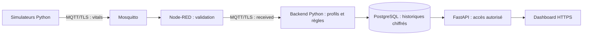

# Architecture simple

La flèche `received` repasse par Mosquitto : le dessin évite de répéter la même boîte.
Le backend revalide le message avant analyse et stockage. Tous les affichages proviennent de son API.

| Composant | Rôle | Fichier à regarder |
| --- | --- | --- |
| Simulateur Python | Générer des observations et reproduire les scénarios | [`src/demo.py`](../src/demo.py), [`examples/step9_live.py`](../examples/step9_live.py) |
| Mosquitto | Distribuer les messages MQTT aux abonnés, avec TLS et ACL | [`compose.secure.yaml`](../compose.secure.yaml), [`infra/mosquitto/acl`](../infra/mosquitto/acl) |
| Node-RED | Recevoir, contrôler le format et router acceptations/rejets | [`infra/node-red/flows.json`](../infra/node-red/flows.json), [`validator.cjs`](../infra/node-red/validator.cjs) |
| Backend Python | Valider, appliquer profils/règles, gérer états et alertes | [`src/web/receiver.py`](../src/web/receiver.py), [`src/processing/persistent_monitoring.py`](../src/processing/persistent_monitoring.py) |
| PostgreSQL | Conserver mesures, alertes, événements, comptes et consentements | [`src/repositories/postgres_store.py`](../src/repositories/postgres_store.py) |
| FastAPI | Contrôler session, rôle et consentement avant de fournir les données | [`src/web/app.py`](../src/web/app.py), [`security.py`](../src/web/security.py) |
| Dashboard | Surveillance, Alertes et Administration, plus connexion | [`src/web/static/`](../src/web/static/) |

## Ce qui configure le métier

- [`config/patients.json`](../config/patients.json) : patients fictifs, profils et consentements de simulation.
- [`config/monitoring-rules.json`](../config/monitoring-rules.json) : seuils, combinaisons et tendances.
- [`config/validation-policy.json`](../config/validation-policy.json) : unités, bornes techniques et fraîcheur.
- [`config/connection-policy.json`](../config/connection-policy.json) : appareils, paramètres attendus et délais.

Redémarrer les services et le serveur après une modification de configuration. Les décisions de
consentement enregistrées en base prévalent sur les consentements fictifs du fichier.
Il n’y a qu’un processus de surveillance par schéma PostgreSQL.

## Accès locaux

| Accès | Démo avec `--node-red` | Mode sécurisé normal |
| --- | --- | --- |
| Dashboard | HTTPS 127.0.0.1:8000 | Identique |
| MQTT | TLS 127.0.0.1:8883 | Identique |
| PostgreSQL | 127.0.0.1:5433 par défaut | Identique |
| Éditeur Node-RED | HTTPS 127.0.0.1:1880, authentifié, lecture seule | Fermé |
| Premier compte | Initialisation explicite, seulement si aucun compte | Bootstrap manuel |

Le profil historique `compose.yaml` seul reste destiné aux anciens tests MQTT sans TLS.
Il ne constitue pas le chemin de démonstration présenté dans le README.
Les [détails UML historiques](uml_traceability.md) restent disponibles en complément.
