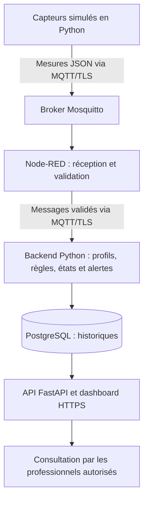

# Smartcare — Comprendre les 12 étapes

Smartcare est un **prototype de télésurveillance de plusieurs patients et de plusieurs paramètres physiologiques**. Des capteurs simulés produisent les mesures ; le système les vérifie, applique les règles des profils du patient, conserve les résultats et affiche les alertes. Il assure un suivi selon des règles configurées, sans poser de diagnostic.

Le patient est la personne suivie. Le médecin et l'infirmier consultent le suivi ; l'administrateur gère les comptes et les consentements. Dans ce prototype, les patients, profils et règles se configurent dans les fichiers de `config/`.

## Vue d'ensemble

**MQTT** est le protocole de transmission ; **Mosquitto** distribue les messages ; **Node-RED** organise leur réception et leur validation. Le **backend Python** analyse les mesures. **PostgreSQL** les conserve et le **dashboard** les présente.

## Étape 1 — Définir les patients et leurs profils

Chaque `Patient` possède un identifiant, un nom, une activation du suivi et un ou plusieurs `ClinicalProfile`. Trois profils existent : **diabète**, **hypertension** et **anxiété / suivi du stress**. Ils déterminent les paramètres prioritaires et les règles à appliquer, sans exclure les autres mesures.

**Exemple :** P001 peut cumuler diabète et hypertension ; le système surveille alors notamment sa glycémie et sa pression artérielle.

[Documentation détaillée](step1_profiles.md)

## Étape 2 — Donner une structure aux mesures

L'objet central, `Measurement`, indique **quel patient, quel appareil, quel paramètre, quelle valeur, quelle unité, quelle date et quelle qualité**. Les huit paramètres sont : fréquence cardiaque, SpO₂, température, pression artérielle, glycémie, respiration, HRV et activité. La pression comporte deux valeurs, systolique et diastolique : cela donne neuf mesures scalaires par cycle complet.

**Exemple :** « P001, capteur SIM_P001, fréquence cardiaque = 84 bpm, mesure valide, à telle heure ». Les métadonnées IEEE 11073 apportent une correspondance de nomenclature **partielle**, documentée.

[Documentation détaillée](step2_measurements.md)

## Étape 3 — Simuler les capteurs

`SensorSimulator` génère les mesures d'un patient. Les stratégies permettent de reproduire un comportement **normal**, une anomalie **progressive**, une anomalie **brutale**, des **données manquantes** et une **récupération**. L'appareil peut aussi être arrêté pour simuler une panne, puis rétabli.

**Exemple :** une fréquence cardiaque monte progressivement, tandis que les valeurs d'un autre patient restent indépendantes.

[Documentation détaillée](step3_simulation.md)

## Étape 4 — Transmettre avec MQTT, Mosquitto et Node-RED

`MQTTPublisher` publie les mesures JSON sur un topic, par exemple `health/P001/vitals`. Mosquitto les transmet au flow Node-RED abonné. Le flow renvoie les mesures acceptées sur un topic de réception utilisé par le backend.

**Résultat :** une mesure produite en Python traverse réellement les composants de communication. Le profil final sécurise ce trajet avec TLS, ajouté à l'étape 10.

[Documentation détaillée](step4_mqtt_nodered.md)

## Étape 5 — Vérifier les données reçues

`DataValidator` et le flow Node-RED contrôlent le JSON, les champs obligatoires, l'identité du patient, les unités, les bornes techniques, les dates, la qualité et les métadonnées. Ils utilisent une politique commune pour garder les vérifications cohérentes.

**À comprendre :** une donnée techniquement invalide est rejetée ; une valeur inhabituelle mais techniquement recevable est transmise au moteur de règles pour être analysée.

[Documentation détaillée](step5_validation.md)

## Étape 6 — Analyser selon les profils

`AnomalyDetector` applique les règles communes et celles des profils du patient. Trois familles existent : **seuil** sur une valeur, **combinaison** de plusieurs paramètres et **tendance** dans le temps. L'analyse vérifie aussi la fraîcheur des observations et sépare les historiques des patients.

**Exemple :** le profil stress examine ensemble fréquence cardiaque, HRV, respiration et activité. Une fréquence cardiaque élevée seule ne devient pas un diagnostic d'anxiété.

[Documentation détaillée](step6_rules.md)

## Étape 7 — Gérer les états et la vie des alertes

`AlertEngine` ouvre, actualise et résout les alertes. Une anomalie persistante met à jour le même épisode ; une récidive après résolution ouvre un nouvel épisode. La résolution exige des observations normales renouvelées, pas simplement un silence du capteur.

`MonitoringStateManager` attribue un état au patient : **NORMAL**, **SURVEILLANCE**, **ALERT**, **CRITICAL** ou **DISCONNECTED**. `SURVEILLANCE` peut notamment signifier que les informations sont encore insuffisantes pour conclure à un suivi normal.

[Documentation détaillée](step7_alerts_states.md)

## Étape 8 — Conserver les historiques dans PostgreSQL

Les repositories enregistrent les **mesures**, les **alertes** et les **événements techniques**. Les transactions évitent les sauvegardes partielles et la déduplication empêche qu'un même message reçu plusieurs fois crée plusieurs mesures. Les alertes actives sont restaurées au redémarrage.

**Résultat :** les données survivent à l'arrêt de l'application. PostgreSQL fonctionne dans Docker avec un volume persistant ; le chiffrement des charges de mesures et d'alertes est ajouté à l'étape 12.

[Documentation détaillée](step8_postgresql.md)

## Étape 9 — Afficher le suivi dans le dashboard

FastAPI sert l'API et une interface en HTML, CSS et JavaScript. Elle permet de **sélectionner un patient**, voir ses profils et dernières mesures, consulter les **courbes**, filtrer les **alertes** et lire le **journal des états**. Les anciennes valeurs sont signalées et l'affichage s'adapte au mobile.

**Résultat :** les professionnels peuvent consulter les données stockées, avec une actualisation automatique toutes les trois secondes. Le dashboard final utilise JavaScript natif, sans React.

[Documentation détaillée](step9_dashboard.md)

## Étape 10 — Sécuriser les accès et les communications

La connexion utilise les rôles **ADMIN**, **DOCTOR** et **NURSE**, contrôlés côté serveur. Les mots de passe sont hachés avec Argon2id, les sessions expirent et les actions importantes sont auditées. L'administrateur dispose d'une page de gestion des comptes.

**Protection du transport :** MQTT utilise TLS, des identifiants et des permissions par topic ; le dashboard utilise HTTPS. Aucun compte administrateur à mot de passe par défaut n'est installé.

[Documentation détaillée](step10_security.md)

## Étape 11 — Gérer les pannes, la reprise et les données manquantes

`ConnectionMonitor` surveille les appareils et paramètres attendus. Une absence prolongée de mesures valides ouvre un incident de **déconnexion**. Si l'appareil émet encore mais qu'un paramètre manque, un incident de **données manquantes** est ouvert. Leur résolution exige le retour de données fraîches.

**Exemple :** P001 devient déconnecté pendant que P002 continue normalement. La reconnexion de P001 résout l'incident technique, mais ne suffit pas à résoudre ses alertes physiologiques. Les messages émis pendant une coupure ne sont pas garantis récupérables.

[Documentation détaillée](step11_connections.md)

## Étape 12 — Valider l'ensemble et compléter la confidentialité

Les tests vérifient les composants, leur fonctionnement ensemble, les scénarios dégradés et les parcours navigateur. Les **KPI**, ou indicateurs de performance, mesurent notamment la livraison des messages et les délais de traitement.

Cette étape ajoute aussi **`Consent`** et **`EncryptionService`** : un consentement absent ou retiré bloque la collecte persistante et masque le suivi ; les charges de mesures et d'alertes sont chiffrées dans PostgreSQL. Les anciens historiques sont conservés lors de la migration. Les index et certaines métadonnées SQL restent en clair.

**Validation du 9 octobre 2026 :** 387 tests distincts réussis, trois parcours navigateur validés et 163 mesures valides sur 163 stockées dans le scénario KPI, sans doublon ni message invalide stocké.

[Documentation détaillée](step12_validation.md) · [Résultats des tests](../reports/step12_tests.md) · [KPI mesurés](../reports/step12_kpi.md)

## Exemple complet : le trajet d'une mesure

Le simulateur de P001 produit une glycémie. Le message JSON passe par Mosquitto puis Node-RED, qui vérifie sa structure. Le backend vérifie le consentement, valide la mesure et applique notamment les règles du profil diabète. Si une règle est déclenchée, il crée ou actualise l'alerte et recalcule l'état du patient. Mesure et alerte sont enregistrées sous forme chiffrée, puis rendues consultables dans le dashboard après authentification.

Si le capteur cesse ensuite d'envoyer ses données, un incident technique s'ajoute au suivi. Le retour des mesures permet de rétablir la connexion ; la récupération physiologique est évaluée séparément.

## Pour retrouver les informations pratiques

| Besoin | Document ou fichier |
| --- | --- |
| Installer et lancer l'application | [README](../README.md) |
| Comprendre le lien entre UML et code | [Traçabilité UML](uml_traceability.md) |
| Définir les patients et leurs profils | [`config/patients.json`](../config/patients.json) |
| Modifier les règles de démonstration | [`config/monitoring-rules.json`](../config/monitoring-rules.json) |
| Configurer les contrôles techniques des mesures | [`config/validation-policy.json`](../config/validation-policy.json) |
| Définir les capteurs attendus et les délais | [`config/connection-policy.json`](../config/connection-policy.json) |

Le prototype est destiné à la démonstration pédagogique. Les règles ne sont pas des protocoles médicaux validés et la correspondance IEEE 11073 reste partielle. La clé privée `.secrets/storage.key` doit être conservée pour pouvoir relire les historiques chiffrés.
